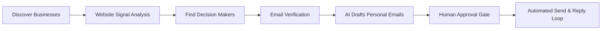

<p align="center">
  <h1 align="center">Sellbird — Extended Open-Source AI Outreach Platform</h1>
  <p align="center">
    <strong>Autonomous B2B Sales Prospecting, Company Profiling, Cold Email Generation & Reply Handling.</strong>
  </p>
  <p align="center">
    <em>Now powered by ANY Open-Source or Proprietary LLM via Direct API (Groq, Google Gemini, NVIDIA NIM, DeepSeek, vLLM, Ollama).</em>
  </p>
</p>

<p align="center">
  <a href="LICENSE"></a>
  
  
  
  
  
</p>

---

## 🌟 Why this Fork?

Original **Sellbird** (formerly Harvey) is an exceptional autonomous outreach engine, but it **strictly restricted users to active Claude Pro/Max or ChatGPT Codex subscriptions**. 

This community-extended edition removes that bottleneck entirely, giving you **100% freedom to Bring Your Own Keys (BYOK)**:

| Feature | Original Sellbird | Sellbird (This Extended Edition) |
| :--- | :---: | :---: |
| **Claude Code CLI headless** | ✅ | ✅ |
| **ChatGPT Codex CLI** | ✅ | ✅ |
| **Groq (Llama 3.3 70B)** | ❌ | ✅ **(Ultra-Fast, Free tier available)** |
| **Google Gemini (Gemini 2.5 Flash)** | ❌ | ✅ **(Generous free quotas via AI Studio)** |
| **NVIDIA NIM (DeepSeek / Llama)** | ❌ | ✅ **(High throughput enterprise inference)** |
| **Custom OpenAI-Compatible API** | ❌ | ✅ **(vLLM, Ollama, DeepSeek API, OpenRouter)** |
| **Self-Hosting on any Linux VPS** | Requires Headless Auth | ✅ **Native single-command deployment** |

---

## 🎯 What Sellbird Does End-to-End



1. **Find Target Companies:** Searches businesses matching your ICP using OpenStreetMap (free) or specialized listings.
2. **Deep Website Signals:** Scrapes prospect websites without model calls to identify buying triggers (e.g. hiring, missing features, ad tech).
3. **Identifies Decision-Makers:** Pinpoints founders, CEOs, and heads of department directly from published pages.
4. **Verifies Email Addresses:** Cross-checks patterns and tests deliverability via Reoon, Hunter, or ZeroBounce.
5. **Generates Hyper-Personalized Emails:** The AI Brain crafts relevant, concise 2-email sequences specific to each prospect.
6. **Safety First (Outbox Gate):** Nothing leaves your mailbox without your manual approval in the Dashboard (unless you toggle autopilot).
7. **Handles Replies:** Categorizes prospect responses (Interested, Objection, Unsubscribe) and drafts intelligent follow-ups.

---

## ⚡ Quick Start Guide

### 1. Clone & Setup Virtual Environment

```bash
git clone https://github.com/Soumik22-tech/sellbird-openai-compatible-api-version.git sellbird
cd sellbird

# Create and activate an isolated virtual environment
python3 -m venv venv
source venv/bin/activate       # On Windows: .\venv\Scripts\activate

# Install dependencies in editable mode
pip install --upgrade pip
pip install -r requirements.txt
pip install -e .
```

### 2. Configure Your LLM Provider (`.env` & `sellbird.yaml`)

Copy `.env.example` to `.env`:
```bash
cp .env.example .env
```

Pick your preferred model provider:

#### Option A: Groq (Recommended — Blazing Fast & Free Tier)
In `.env`:
```env
GROQ_API_KEY=gsk_your_groq_key_here
```
In `sellbird.yaml`:
```yaml
brain:
  provider: "groq"
  model: "llama-3.3-70b-versatile"
```

#### Option B: Google Gemini
In `.env`:
```env
GEMINI_API_KEY=AIzaSy_your_gemini_key_here
```
In `sellbird.yaml`:
```yaml
brain:
  provider: "gemini"
  model: "gemini-2.5-flash"
```

#### Option C: NVIDIA NIM / DeepSeek
In `.env`:
```env
NVIDIA_API_KEY=nvapi_your_nvidia_key_here
```
In `sellbird.yaml`:
```yaml
brain:
  provider: "nvidia"
  model: "deepseek-ai/deepseek-r1"
```

---

## 🖥️ Running the Platform

### Start the Web Dashboard
```bash
sellbird dashboard
```
Open **`http://127.0.0.1:5555`** in your browser to access the control panel.

### Start Outreach & Processing Loop
```bash
sellbird run
```

---

## 🌐 Self-Hosting on Linux VPS (24/7 Deployment)

To run this platform 24/7 on Ubuntu/Debian:
1. Clone the repo and set up your virtual environment as shown above.
2. Set up standard `systemd` background services for both `sellbird dashboard` and `sellbird run`.
3. Open port `5555` in your firewall (`sudo ufw allow 5555/tcp`).
4. Access your control dashboard from anywhere via `http://YOUR_VPS_IP:5555`.

---

## ⚖️ Legal & License

This software is distributed under the **GNU Affero General Public License v3.0 (AGPL-3.0)** in complete compliance with the upstream project license.

- **Upstream Project:** [Sellbird (formerly Harvey)](https://github.com/ethanplusai/sellbird)
- **Copyright (C):** 2026 Ethan Rogers and the Sellbird contributors.
- **Extended Architecture & Custom API Layer:** Developed by [Soumik22-tech](https://github.com/Soumik22-tech).
- Full legal terms are available in [LICENSE](LICENSE) and [NOTICE](NOTICE).

---

<p align="center">
  <sub>Built with ❤️ for the open-source and self-hosting community. If you find this project useful, please consider giving it a ⭐ on GitHub!</sub>
</p>
